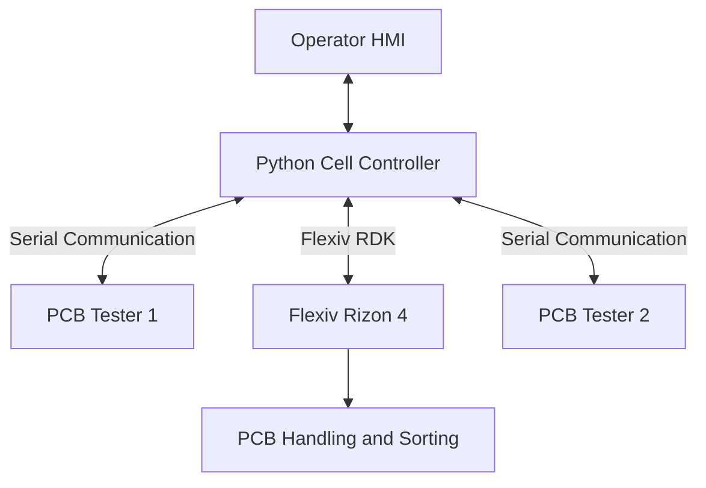

<h1 align="center">👋 Hi, I'm David Ceballos</h1>

<h3 align="center">Mechatronics Engineer | Robotics & Autonomous Systems</h3>

  Designing, building and integrating intelligent electromechanical systems.

  
  
  
  
  
  
  

---

## 👨‍💻 About Me

I'm a Mechatronics Engineer passionate about designing, building, integrating and improving robotic systems.

I currently work as a Field Service Engineer, supporting autonomous mobile robotic systems deployed in large-scale warehouse automation environments.

My engineering experience spans mechanical design, embedded systems, robotic integration, control software, system commissioning and technical troubleshooting.

---

## 🛠️ Technical Expertise

- 🤖 **Robotics:** AMRs, AGVs, industrial robotic arms and system integration.
- 💻 **Software:** Python, C/C++, SQL and TCP/IP communication.
- 🔌 **Embedded Systems:** ESP32, microcontrollers, motor drivers and sensor integration.
- ⚙️ **Mechanical Engineering:** CAD, electromechanical design, rapid prototyping and additive manufacturing.
- 📈 **Control Systems:** PID control, motion control and system validation.

---

## 🚀 Featured Projects

### 🤖 [Robotic PCB Testing Cell](https://github.com/davidrcm1/PCB-Testing-COBOT)

Development and integration of an automated PCB testing cell using a Flexiv Rizon 4 collaborative robotic arm, integrating existing industrial testing equipment into a centralised automation system.

#### 🎬 System Demonstration

  
  &nbsp;&nbsp;&nbsp;
  

#### ⚙️ System Architecture

#### 🔄 Automated Testing Workflow

The controller independently monitors multiple testing machines, enabling concurrent testing cycles while coordinating access to a shared robotic arm.

#### 📐 Mechanical Design & Prototyping

  
  &nbsp;&nbsp;&nbsp;
   
  &nbsp;&nbsp;&nbsp;
  

#### 💻 Controller Application & HMI

  

**Technologies and skills:**

**[📂 View Full Project Documentation & Source Code](https://github.com/davidrcm1/PCB-Testing-COBOT)**

---

### 🎯 [Vision-Based Tracking Turret](https://github.com/davidrcm1/Turret)

Development of an embedded pan-and-tilt platform incorporating custom mechanical assemblies, stepper motor control and network-based communication, with computer vision integration under development.

  
  &nbsp;&nbsp;&nbsp;&nbsp;&nbsp;&nbsp;
  

**Technologies and skills:**

---

### 🗺️ [Autonomous Mobile Robot – SLAM & Frontier-Based Exploration](https://github.com/davidrcm1/AMR---SLAMs---Auto-exploration)

Development of a ROS 2-based autonomous mobile robot capable of mapping and exploring unknown environments using LiDAR-based SLAM, autonomous navigation and custom frontier-based exploration algorithms.

The system integrates a simulated differential-drive robot, A* path planning, obstacle avoidance and a custom HMI for manual control, autonomous exploration and map management.

  
  &nbsp;&nbsp;&nbsp;
  

**Technologies and skills:**

---

---

### 🫀 [Physiological Pressure Waveform Replicator](https://github.com/davidrcm1/PID-Physiological-Pressure-Waveform-Replicator)

Development of a closed-loop low-cost pressure control system using PID control to replicate physiological pressure waveforms.

  
  

**Technologies and skills:**

---

## 🔬 Engineering Interests

- 🤖 Autonomous robotic systems
- 💻 Embedded software development
- 👁️ Computer vision
- ⚙️ Electromechanical product development
- 📐 Robotic motion and control systems

---

## 🌐 Connect

📍 Sydney, Australia

